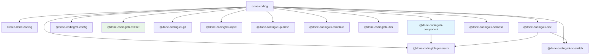

# done-coding

> ⚠️ **子命令移除说明**：`ai`（AI 对话）与 `mrm`（模型源管理）两个子命令已移除——AI 对话改用 `dex`（[@done-coding/cli-dex](https://www.npmjs.com/package/@done-coding/cli-dex)，Dex 智能体），模型 / 服务商切换改用 `cc-switch`。无子命令运行 `DC` 现直接输出帮助。

done-coding 命令行工具集 - 提供完整的开发工作流支持

[](https://www.npmjs.com/package/done-coding)
[](https://opensource.org/licenses/MIT)

## 安装

### 全局安装（推荐）

```bash
npm install -g done-coding
# 或使用 pnpm
pnpm add -g done-coding
```

### 本地安装

```bash
npm install done-coding
# 或使用 pnpm
pnpm add done-coding
```

## 两种命令入口

装了主包就用 `done-coding <X> …`；只装子包就用 `dc-<X> …`，参数完全一致：

| 主包入口                | 独立子包入口                                                        |
| ----------------------- | ------------------------------------------------------------------- |
| `done-coding create`    | `dc-create`（兼容 `create-done-coding` / `npm create done-coding`） |
| `done-coding generator` | `dc-generator`                                                      |
| `done-coding harness`   | `dc-harness`                                                        |
| `done-coding component` | `dc-component`                                                      |
| `done-coding config`    | `dc-config`                                                         |
| `done-coding extract`   | `dc-extract`                                                        |
| `done-coding git`       | `dc-git`                                                            |
| `done-coding inject`    | `dc-inject`                                                         |
| `done-coding publish`   | `dc-publish`                                                        |
| `done-coding template`  | `dc-template`                                                       |
| `done-coding cc-switch` | `dc-cc-switch`（兼容 `cc-router`）                                  |
| `done-coding dex`       | `dc-dex`（兼容 `dex`）                                              |

主包全局安装只注册自身的 `DC` / `dc-cli` / `done-coding`，不会把依赖子包的 bin 放入 PATH，也不声明这些子包 bin。两者同装时各用各的副本，`done-coding <X>` 用主包该版本钉死的子包版本；skill 优先使用它。`dc-mcp` / `dc-cli-skills` 是独立入口，未挂主命令。

```bash
# 装主包后
done-coding create --help
# 或只装 create 子包后
npm install -g create-done-coding
dc-create --help
```

未安装时可 `npx <子包>@latest …`；多 bin 包（cli-dex / cli-cc-switch）须显式指定：`npx -p <包>@latest <bin> …`。

## 快速开始

安装完成后，您可以使用以下命令启动：

### 安装后提示

根据您的操作系统，使用方式略有不同：

#### 可用命令

根据 package.json 的 bin 配置，以下命令在所有系统中都可用：

```bash
# 主要命令（推荐）
DC [命令]           # 大写 DC 命令
dc-cli [命令]       # 完整 CLI 命令
done-coding [命令]  # 完整品牌命令

# 查看帮助
DC --help
dc-cli --help
done-coding --help
```

⚠️ **重要提示**:

- 推荐使用大写的 `DC` 命令，在所有系统中都可用
- 可以使用 `dc-cli` 或 `done-coding` 作为替代命令
- **系统差异说明**:
  - **Windows 系统**: 可以使用小写 `dc` 命令（系统对大小写不敏感且无系统dc命令）
  - **macOS/Linux 系统**: 不建议使用小写 `dc` 命令（避免与系统dc命令冲突）

## Shell 补全

基于 yargs 内置补全（zsh / bash），候选由运行时自省命令注册表生成——**新增子命令与选项自动进补全**，无需维护静态补全脚本。

```bash
# zsh（OSX 建议 .zprofile）
echo 'source <(done-coding completion zsh)' >> ~/.zshrc
# 脚本默认只注册主命令 `DC`；若用别名命令 done-coding / dc-cli，补一行注册
echo 'compdef _DC_yargs_completions done-coding dc-cli' >> ~/.zshrc
source ~/.zshrc

# bash
echo 'source <(done-coding completion bash)' >> ~/.bashrc
source ~/.bashrc
```

补全效果（前缀过滤由 shell 侧完成）：

- `done-coding <TAB>` — 全部子命令（git / cc-switch / generator / ...）
- `done-coding cc-switch --<TAB>` — meta 选项（`--meta-pick` / `--meta-help` / `--meta-version` / `--meta-profile=`）
- `done-coding generator <TAB>` — 嵌套子命令（add / remove / list / assemble / ...）

## 功能特性

- ✅ **统一入口**: 集成 12 个专业工具包，提供统一的命令行入口
- 🚀 **跨平台兼容**: 支持 Windows、macOS、Linux，自动处理系统差异
- 🔧 **模块化设计**: 每个子包独立开发，可单独使用或集成使用
- 📦 **完整工作流**: 涵盖项目创建、开发、构建、发布的完整流程
- 🔄 **包间协作**: 智能的包间功能调用，如 config 包调用 git 包的合并检测

## API 文档

done-coding 集成了多个工具，每个工具都专注于特定的开发任务：

### 🚀 项目创建

- **命令**: `DC create`
- **描述**: 从模板创建项目；支持预设答案非交互创建（供 AI / 脚本调用）
- **包地址**: [create-done-coding](https://www.npmjs.com/package/create-done-coding)
- **常用选项**:
  - `-n, --projectName` 项目名称 · `-p, --templateUrl` 模板地址 · `-b, --templateGitBranch` 模板分支 · `--templateDirectory` 仓库内模板目录
  - `--templateConfig` 本次使用的模板清单文件
  - `--env '<JSON>'` / `--envFile <文件>` 预设模板问题的答案；`--listQuestions` 只打印模板问题清单
- **子命令**:
  - `DC create instances ls|prune` 查看 / 清理本机创建过的项目记录
  - `DC create template-config [path]` 查看 / 登记本机默认模板清单（`--unset` 清除），之后 `DC create` 不再需要每次传 `--templateConfig`

### 🔧 组件生成

- **命令**: `DC component`
- **描述**: 组件命令行工具
- **包地址**: [@done-coding/cli-component](https://www.npmjs.com/package/@done-coding/cli-component)

### 🏭 通用批次生成

- **命令**: `DC generator`（bin `dc-generator`）
- **描述**: 通用具名批次生成器（content-free 机制层）—— add/modify/remove/list/init 批次实例 + assemble 模板组装（配方→物化 + 漂移闸）；`component` 即其 component 预设薄包装
- **包地址**: [@done-coding/cli-generator](https://www.npmjs.com/package/@done-coding/cli-generator)

### ⚙️ 工程配置

- **命令**: `DC config`
- **描述**: 工程化配置命令行工具
- **包地址**: [@done-coding/cli-config](https://www.npmjs.com/package/@done-coding/cli-config)

### 📤 信息提取

- **命令**: `DC extract`
- **描述**: 信息提取命令行工具
- **包地址**: [@done-coding/cli-extract](https://www.npmjs.com/package/@done-coding/cli-extract)

### 🔄 Git 操作

- **命令**: `DC git`
- **描述**: git跨平台操作命令行工具
- **包地址**: [@done-coding/cli-git](https://www.npmjs.com/package/@done-coding/cli-git)

### 💉 信息注入

- **命令**: `DC inject`
- **描述**: 信息(JSON)注入命令行工具
- **包地址**: [@done-coding/cli-inject](https://www.npmjs.com/package/@done-coding/cli-inject)

### 📦 项目发布

- **命令**: `DC publish`
- **描述**: 项目发布命令行工具
- **包地址**: [@done-coding/cli-publish](https://www.npmjs.com/package/@done-coding/cli-publish)

### 📝 模板处理

- **命令**: `DC template`
- **描述**: 预编译命令行工具
- **包地址**: [@done-coding/cli-template](https://www.npmjs.com/package/@done-coding/cli-template)

### 🔀 模型路由

- **命令**: `DC cc-switch`
- **描述**: claude-code 模型路由透传（`dc-cc-switch` / `cc-router`），按 profile 注入 env 启动 claude；支持 `--meta-pick` 交互选择、`--meta-profile=<name>` 显式指定
- **包地址**: [@done-coding/cli-cc-switch](https://www.npmjs.com/package/@done-coding/cli-cc-switch)

### 🤖 Dex 智能体

- **命令**: `DC dex`（bin `dc-dex`，兼容 `dex`）
- **描述**: 自带 done-coding 工具的编码智能体，直接进入对话；首次启动导入 cc-switch 的模型配置（要求 Node.js >= 22.19.0）
- **包地址**: [@done-coding/cli-dex](https://www.npmjs.com/package/@done-coding/cli-dex)

### 📋 工作区治理

- **命令**: `DC harness`（bin `dc-harness`）
- **描述**: harness-workspace 治理工具：重生成治理清单、跑治理闸、向兄弟仓提 issue、维护仓库注册表
- **包地址**: [@done-coding/cli-harness](https://www.npmjs.com/package/@done-coding/cli-harness)

## 在 AI 编码工具里使用

Claude Code 与 Codex 可安装插件 `done-coding`，让 AI 按任务调用上面的命令（用模板建项目、代码生成、治理清单与跨仓 issue）：

```bash
# Claude Code（会话内）
/plugin marketplace add done-coding/done-coding-agent-plugins
/plugin install done-coding@done-coding

# Codex
codex plugin marketplace add done-coding/done-coding-agent-plugins
codex plugin add done-coding@done-coding
```

插件内容即 npm 包 [@done-coding/cli-skills](https://www.npmjs.com/package/@done-coding/cli-skills)，详见 [done-coding-agent-plugins](https://github.com/done-coding/done-coding-agent-plugins)。

## 完整命令列表

### 基于实际 CLI 输出的命令

```bash
# 项目管理
DC create                                 # 交互式创建新项目
DC create -n my-app --env '{...}'         # 预设答案非交互创建
DC create instances ls|prune              # 查看 / 清理本机创建记录
DC create template-config [path]          # 查看 / 登记默认模板清单（--unset 清除）

# 组件管理
DC component add <name>                   # 新增组件
DC component remove [name]                # 删除组件
DC component list                         # 展示组件列表

# 通用批次生成（dc-generator）
DC generator list [type]                  # 列出批次/批次实例
DC generator init <type>                  # 初始化批次骨架
DC generator add <type> <name>            # 添加实例
DC generator modify <type> <name>         # 原位修改 insert 块的值
DC generator remove <type> <name>         # 移除实例
DC generator assemble plan|build|diff|check  # 模板组装 + 漂移闸

# 模型路由（dc-cc-switch）
DC cc-switch [claude 参数...]             # 模型路由透传启动 claude
DC cc-switch --meta-pick                  # 交互选择 profile 启动
DC cc-switch --meta-profile=<name>        # 显式指定 profile 启动
DC cc-switch --meta-help                  # 自身帮助

# Dex 智能体（dex）
DC dex                                    # 进入 Dex 对话

# 工作区治理（dc-harness）
DC harness lists [--check]                # 重生成 / 校验治理清单
DC harness check                          # 治理闸
DC harness issue <仓名或仓根> -t -s -b      # 向兄弟仓提 issue
DC harness scope list|check|register      # 仓库注册表

# 工程化配置
DC config                                 # 工程化配置命令行工具

# 信息处理
DC extract                                # 信息提取命令行工具
DC inject                                 # 信息(JSON)注入命令行工具

# 模板处理
DC template                               # 预编译命令行工具

# Git 操作（供 git hooks 等调用，不在 DC --help 中列出）
DC git init                               # 初始化配置文件
DC git clone <platform> <username>       # 从选择的git平台克隆代码
DC git hooks <name> [args...]             # git钩子回调
DC git check <type>                       # 检查git操作

# 项目发布
DC publish                                # 项目发布命令行工具
```

### 使用替代命令

```bash
# 使用完整命令名
dc-cli [command]                          # 完整CLI命令
done-coding [command]                     # 完整品牌命令
```

## 使用示例

### 创建新项目

```bash
# 使用主要命令
DC create
DC create -n my-app

# 登记一次默认模板清单，之后创建时直接从中选模板
DC create template-config ./templates.json

# 使用替代命令
dc-cli create -n my-app
done-coding create -n my-app
```

### 组件管理

```bash
# 使用主要命令
DC component add Button
DC component remove Button
DC component list

# 使用替代命令
dc-cli component add Button
done-coding component list
```

### Git 操作

```bash
# 使用主要命令
DC git init
DC git clone gitee username
DC git hooks pre-commit
DC git check reverse-merge

# 使用替代命令
dc-cli git init
done-coding git clone gitee username
```

### 模板处理

```bash
# 使用主要命令
DC template

# 使用替代命令
dc-cli template
done-coding template
```

### 项目发布

```bash
# 使用主要命令
DC publish

# 使用替代命令
dc-cli publish
done-coding publish
```

## 配置

没有统一的配置文件，各子命令的配置分两处：

- **项目内**：`<项目根>/.done-coding/<命令名>/...`，如 generator 的批次配置 `.done-coding/<type>/`、assemble 配方 `.done-coding/generator/assemble/`、harness 的 `.done-coding/harness/governance/config.json`。
- **本机**：`~/.done-coding/<命令名>/...`，如 create 的模板清单指针 `~/.done-coding/create/index.json`、harness 的仓库注册表 `~/.done-coding/harness/scope/`。

具体字段见各子包 README。

## 架构设计

done-coding CLI 采用模块化架构，每个子包都是独立的工具：

### 包依赖关系



### 包间协作关系

- **@done-coding/cli-config** → **@done-coding/cli-git**:
  - config 包的 `merge-lint` 模块调用 git 包的 `check reverse-merge` 命令
  - 实现工程化配置中的 git 合并规范检测
- **所有子包** → **@done-coding/cli-utils**:
  - 提供通用的 CLI 工具函数和类型定义
  - 统一的配置文件读取和命令行参数处理

### 目录结构

```
done-coding (主包)
├── create-done-coding (项目创建)
├── @done-coding/cli-component (组件生成)
├── @done-coding/cli-generator (通用批次生成 / assemble)
├── @done-coding/cli-config (工程配置)
├── @done-coding/cli-extract (信息提取)
├── @done-coding/cli-git (Git 操作)
├── @done-coding/cli-inject (信息注入)
├── @done-coding/cli-publish (项目发布)
├── @done-coding/cli-template (模板处理)
├── @done-coding/cli-cc-switch (模型路由)
├── @done-coding/cli-dex (Dex 智能体)
├── @done-coding/cli-harness (工作区治理)
└── @done-coding/cli-utils (工具库)
```

独立 bin、不挂在 `DC` 下的包：`@done-coding/cli-mcp`（`dc-mcp`，MCP server）、`@done-coding/cli-skills`（`dc-cli-skills`，Agent Skills 及插件内容）。

## 故障排除

### 常见问题

**Q: 命令找不到**

```bash
# 确保全局安装
npm list -g done-coding

# 重新安装
npm uninstall -g done-coding
npm install -g done-coding
```

**Q: 权限错误**

```bash
# macOS/Linux 使用 sudo
sudo npm install -g done-coding

# 或配置 npm 全局路径
npm config set prefix ~/.npm-global
```

**Q: 版本冲突**

```bash
# 清除缓存
npm cache clean --force

# 检查版本
DC --version
```

## 贡献指南

我们欢迎社区贡献！请查看各个子包的具体贡献指南：

- [项目创建工具](https://www.npmjs.com/package/create-done-coding)
- [组件生成工具](https://www.npmjs.com/package/@done-coding/cli-component)
- [通用批次生成工具](https://www.npmjs.com/package/@done-coding/cli-generator)
- [更多工具](https://github.com/done-coding/done-coding-cli)

## 许可证

MIT © [done-coding](https://github.com/done-coding)

## 相关链接

- [Github 仓库](https://github.com/done-coding/done-coding-cli)
- [更新日志](./CHANGELOG.md)
